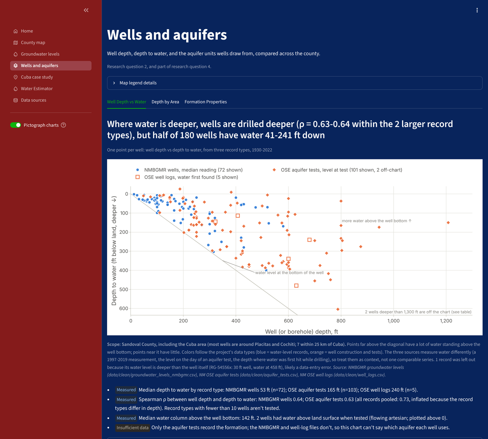

# 4. Streamlit app

**Lead:** Meckrem Yousef

[Open the live app](https://eng220aquiferproject.streamlit.app/)

The interactive dashboard presents the project's results. It's built with Streamlit, pandas, and Plotly, and runs from `ProjectApp.py` in the repository. Meckrem finished it on Nov 14.



*The Wells and aquifers page on a computer screen. The page menu is on the left, the page's charts are in tabs, and each chart's scope, caption, and labeled findings are below it.*

## What the app shows

Each page shows its charts with a one-line takeaway, what is plotted, the chart's scope (Cuba, the Cuba area, or Sandoval County), a caption, the findings labeled *Measured*, *Hypothesis*, or *Insufficient data*, and a "Data behind this chart" table with a CSV download. Charts are interactive: hover for exact values, drag to zoom, double-click to reset. Six charts show small pictograms (wells, stream gages, river visits, rating balls); the **Pictograph charts** switch in the sidebar turns them off to show the plain versions used in the report (see [Pictograph versions](analysis.md#pictograph-versions)).

| Page | What it shows | Research questions |
|---|---|---|
| Home | Project summary, links, and the research questions | All |
| County map | Every site in the project's datasets on a map, colored by what it measures | 1, 5 |
| Groundwater levels | Three tabs: monthly water levels at the 9 USGS monitoring wells, their trends, and Placitas wells re-measured after 20 years | 1 |
| Wells and aquifers | Three tabs: well depth vs depth to water, depth to water by area, and aquifer-test properties by formation (choose the measurement from a menu) | 2, 4 |
| Cuba case study | Three key numbers and a short answer to research question 3, then five tabs: a map of sites near Cuba, the nearest record in each dataset, the USGS Ojo Alamo depth map around Cuba, Ojo Alamo vs San Jose tests, and Rio Puerco visits | 3, 4 |
| Data sources | Dataset list and links (in expandable sections), a timeline of monitoring coverage, a dataset-by-question evidence matrix, aquifer-sensitivity classes, and a table of groundwater-stress indicators | 5, 6 |
| Water Estimator | Estimates a household's daily and monthly water use from everyday activities (showers, toilet flushes, faucet use, laundry, and dishwasher loads), compares the daily total with a New Mexico residential average of 81 gallons a day, and estimates a monthly water bill. The bill's base fee, included gallons, and rate per 1,000 gallons are starting values to replace with the numbers on a Village of Cuba utility statement. | - |

The chart code lives in `analysis/` (see [Analysis and visualizations](analysis.md)); each page file in `app_pages/` calls `show_chart(...)` for its charts. The maps use the free CARTO basemap, which needs an internet connection.

## Look and phone layout

The app's colors are set in `.streamlit/config.toml` under `[theme]`: a navy background, a dark red sidebar, a green accent, and light text.

Meckrem laid out every page to work on a phone as well as a computer:

- **Charts in tabs.** Pages with several charts show them in tabs (such as *Hydrographs*, *Trends*, and *Placitas Remeasured*) instead of one long scroll.
- **Expandable sections.** Each page's legend and longer explanations fold into an expandable section, so the first chart is near the top of the screen.
- **Narrow screens.** On a phone, side padding shrinks, headings get smaller, and the Home page buttons and the Cuba case study's key numbers stack vertically. A few lines of CSS at the top of `ProjectApp.py` and of each page file do this.
- **Touch hints.** The county map says "Pinch to zoom; tap a dot for its records."

On Nov 12, the theme file was fixed so Streamlit could read it again: a block of Python had been pasted into it and its `[theme]` heading removed. The Python, which holds the phone-layout CSS, moved to `ProjectApp.py`. The Sandbox test page, which showed random data, was removed from the menu on Nov 13.

## Running it yourself

In GitHub Codespaces, open a codespace from the repository's **Code** button and the app starts automatically. On your own computer:

```
pip install -r requirements.txt
streamlit run ProjectApp.py
```

## How the live app updates

The live app runs whatever is on the repository's `main` branch and redeploys within about a minute of each push.
